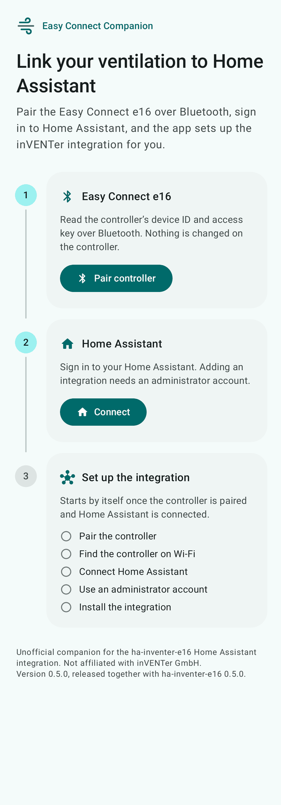
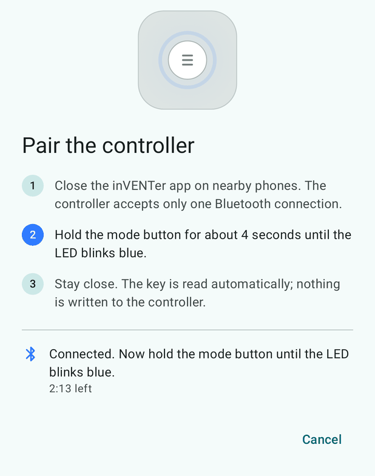
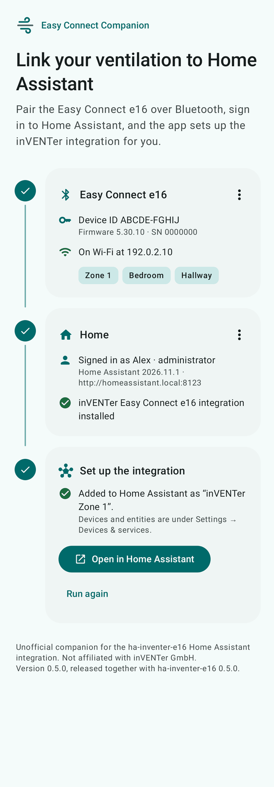
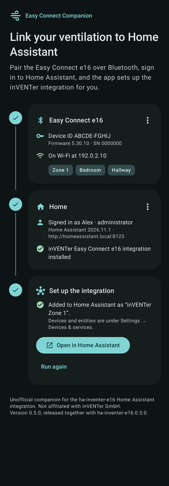

# Easy Connect Companion (Android)

An Android app that sets up this integration from your phone, in three steps:

1. **Pair the controller over Bluetooth.** The app reads device ID and PSK while the controller is
   in pairing mode, like [`tools/e16_onboard.py`](../docs/onboarding.md) does.
2. **Sign in to Home Assistant** on its own login page (OAuth).
3. **The app adds the integration.** As soon as both are done, it runs the `inventer_e16` config
   flow with host, device ID and PSK.

<p>




</p>

> **Unofficial**, like the integration. Not affiliated with, endorsed or supported by
> inVENTer GmbH.

## Install

Download `EasyConnectCompanion-<version>.apk` from the
[releases](https://github.com/tobiask1977/ha-inventer-e16/releases) and open it on the phone
(allow your browser or file manager to install apps). Each release of the integration comes with
the app of the same version, and a newer APK installs as an update.

You need:

- Android 8.0 or newer with Bluetooth LE, on the same network as the controller,
- Home Assistant with this integration installed (see the [README](../README.md#installation))
  and an administrator account: only administrators can add integrations.

## How to use it

1. **Pair:** tap *Pair controller*, close the inVENTer app on nearby phones (the controller accepts one
   Bluetooth connection), then hold the mode button for about 4 seconds until the LED blinks
   blue. The app reads device ID and PSK and looks for the controller on your Wi-Fi.
2. **Home Assistant:** pick your instance (found on the network) or enter its address, then sign
   in.
3. **Integration:** the app adds the controller. If Home Assistant had already discovered it, the
   app completes that discovery. If the controller is set up already, the app gives the entry
   the current address and key (*Reconfigure*, or a pending re-authentication), so entities and
   history stay.

*Show key* in the controller's menu (⋮) shows device ID and PSK, for example to enter them by hand.

## What it does and doesn't do

- **Reads, never writes.** Over Bluetooth the app only reads; it doesn't confirm the PIN, so the
  official app keeps working ([why](../docs/onboarding.md#good-to-know)). Over Wi-Fi it reads the
  zone table to check the key and changes nothing.
- **Stays local.** It talks to the controller and your Home Assistant only. No cloud, no
  analytics.
- **Never sees your Home Assistant password.** The login runs on Home Assistant's own page in an
  in-app browser, as in the Home Assistant app; the app gets a token. *Sign out* revokes it.
- **Keeps secrets encrypted.** PSK and token are encrypted with a key in the Android Keystore and
  excluded from backups. *Forget controller* deletes the key from the phone; Home Assistant keeps
  its own copy.

## How it works

| Part | What it does |
|---|---|
| Bluetooth (`ble/`) | Scans for the controller by name or service UUID and polls the PSK characteristic until pairing mode is open, then reads PSK and device ID ([protocol](../docs/protocol.md#bluetooth-le-onboarding)). Reconnects when the controller drops the link as pairing mode starts. |
| Wi-Fi (`device/`) | Finds the controller with MDSDP (UDP 47818, the discovery of the official app; not verified on an e16) or a sweep of the local /24 for TCP 47820, and checks every candidate with the key: TLS-PSK handshake (identity `zirconia`, `PSK-AES128-CBC-SHA`, BouncyCastle) and a read of the zone table. The address can also be entered by hand. |
| Home Assistant (`ha/`) | Finds Home Assistant via mDNS (`_home-assistant._tcp`) or takes an address. OAuth with the client ID `https://easyconnect-companion.localhost/`: Home Assistant accepts the redirect `…/auth-callback` on the same host without fetching anything, and the in-app browser intercepts it. Checks for an administrator and the installed integration, then drives the config flow like the frontend: `user` step with `host`, `device_id` and `psk`; on `already_in_progress` it completes the DHCP discovery flow; on `already_configured` a pending re-authentication or `reconfigure`. |

The integration is set up once per controller, address, key and Home Assistant; pairing again or a
new address runs it again.

## Versions and releases

The app has no version of its own. Gradle reads `version` from
[`manifest.json`](../custom_components/inventer_e16/manifest.json) as versionName (`0.5.0`,
`0.5.1b1`, …) and derives the versionCode from it, so releases and pre-releases update each other
in order (`0.5.0b1` → 50031, `0.5.0` → 50099, `0.5.1` → 50199).

The workflow [`companion-app.yml`](../.github/workflows/companion-app.yml) runs tests and lint and
builds the APK whenever the app or the integration changes, and runs the app's setup against the
latest Home Assistant with the integration's config flow. Each run keeps the APK as an artifact
for testing; it is signed with a throwaway debug key and can't update a release. When a GitHub
release is published, the workflow checks that the tag is `v` plus the manifest version, signs the
APK with the release key and attaches `EasyConnectCompanion-<version>.apk` and its SHA-256 to the
release.

The release key comes from repository secrets (*Settings → Secrets and variables → Actions*). Only
the publishing job sees them, and only `apksigner` uses them:

| Secret | Content |
|---|---|
| `ANDROID_KEYSTORE_BASE64` | The keystore (PKCS12 or JKS), base64-encoded |
| `ANDROID_KEYSTORE_PASSWORD` | Its password |
| `ANDROID_KEY_ALIAS` | Optional, default `release` |
| `ANDROID_KEY_PASSWORD` | Optional, default: the keystore password |

Create the key once and keep a backup outside the repository. An APK signed with a different key
can't update the installed app.

```bash
keytool -genkeypair -keystore release.p12 -storetype PKCS12 -alias release \
  -keyalg RSA -keysize 4096 -validity 10000 -dname "CN=Easy Connect Companion"
base64 < release.p12 | tr -d '\n'     # value for ANDROID_KEYSTORE_BASE64
```

## Build and test

```bash
cd companion-app
./gradlew :app:assembleRelease                 # app/build/outputs/apk/release, debug-signed
./gradlew :app:testDebugUnitTest :app:lintDebug
```

Needs JDK 17 or newer and the Android SDK (compileSdk 37). For a release-signed local build, set
`ANDROID_KEYSTORE_FILE` and `ANDROID_KEYSTORE_PASSWORD` (optionally `ANDROID_KEY_ALIAS` and
`ANDROID_KEY_PASSWORD`).

| Test | Covers |
|---|---|
| `ZirconiaProtocolTest`, `MdsdpTest`, `FlowParsingTest` | Framing and CRC-8 (checked against a capture in `tests/test_acknowledgements.py`), zone rows, discovery packets, config-flow forms |
| `MockUnitTest` | TLS-PSK client, zone table, MDSDP and the subnet sweep against [`tools/mock_e16.py`](tools/mock_e16.py), a stand-in controller (Python 3.13+, skipped without it) |
| `HomeAssistantIntegrationTest` | Login and config flow against a real Home Assistant with this integration and the stand-in controller: new entry, wrong key, unreachable controller, reconfigure, pending re-authentication, DHCP discovery, non-admin account, token refresh and revoke. Runs when `HA_TEST_URL`, `HA_TEST_USER` and `HA_TEST_PASSWORD` are set, see below |
| `ScreenshotTest` | Renders the main screens (Robolectric); with `-Pscreenshots` into `app/build/outputs/roborazzi`, the source of `docs/screenshots` |

For `HomeAssistantIntegrationTest`, [`tools/ha-test/start.sh`](tools/ha-test/start.sh) starts a
throwaway Home Assistant with the integration's config flow, a helper component that simulates
discovery and re-authentication, and the stand-in controller, and prints the three variables.
Home Assistant needs a virtual environment with the Python version it requires:

```bash
python3 -m venv .venv && . .venv/bin/activate && pip install homeassistant
eval "$(tools/ha-test/start.sh | grep '^export')"
./gradlew :app:testDebugUnitTest --tests '*HomeAssistantIntegrationTest*'
```

All sample data (key `0102030405060708`, device ID `ABCDE-FGHIJ`, addresses from 192.0.2.0/24,
zone names) is made up, as everywhere in this repository.

**Why targetSdk 36?** Android 17 makes local-network access a runtime permission
(`ACCESS_LOCAL_NETWORK`) for apps that target API 37. The manifest declares it and pairing asks
for it on Android 17; before raising the target, the Home Assistant step has to ask for it too.

## Layout

```
app/src/main/java/de/wuerl/easyconnect/
  ble/      Bluetooth scan, GATT wrapper, reading device ID and PSK
  device/   Zirconia framing, TLS-PSK session, MDSDP, finding the controller on the network
  ha/       OAuth, REST and WebSocket API, config-flow driver, mDNS discovery
  data/     Keystore-encrypted storage
  ui/       Compose UI (Material 3), ViewModel
tools/mock_e16.py   Stand-in controller (TLS-PSK and MDSDP) for the tests
tools/ha-test/      Throwaway Home Assistant for the end-to-end test
```
